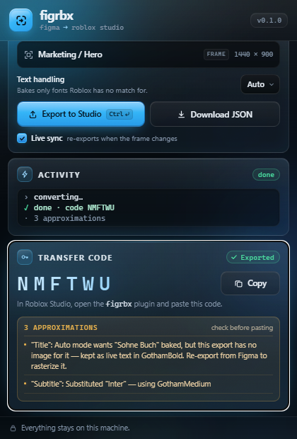

# figrbx

**A free, open-source Figma → Roblox Studio UI converter.**

figrbx ships both halves of the workflow: a **Figma plugin** that reads your
frame, and a **Roblox Studio plugin** that rebuilds it as native GUI instances.
Select a frame, press Export, paste the six-character code in Studio, and the
design arrives as `Frame`, `TextLabel`, `TextButton`, `ScrollingFrame` and
`CanvasGroup` instances with `UICorner`, `UIStroke` and `UIGradient` attached,
sized in Scale so the layout holds on screens you did not design for.

It is an alternative to paid converters, with no subscription, no account, and
no server of ours in the middle: the converter runs on your machine and images
upload to your own Roblox account.

- **Free and MIT licensed** — fork it, modify it, ship it.
- **No API keys required to try it** — designs without images convert with no
  Roblox credentials at all.
- **Nothing leaves your machine** except the images you choose to upload.
- **Every approximation is reported** — nothing is silently dropped.

figrbx is an independent project. It is not affiliated with, endorsed by, or
sponsored by Framewisp, Figma, or Roblox. All product names are used only to
describe what this software interoperates with.



## How it fits together

```
Figma plugin (TypeScript)        Local bridge (Node)                 Studio plugin (Luau)
┌───────────────────────┐  HTTP  ┌───────────────────────┐   HTTP    ┌───────────────────┐
│ read the selected      │ ─────> │ validate + convert    │ <──────── │ fetch by code     │
│ frame, export images   │        │ Roblox OAuth + upload │           │ build instances   │
│ send the design tree   │ <───── │ store revision/code   │ ────────> │ live-sync poller  │
└───────────────────────┘        └───────────────────────┘           └───────────────────┘
```

Everything runs on your machine. The bridge binds to `localhost` and talks to
Roblox only when you import images into your own account.

A static path also exists: **Download JSON** in the Figma plugin produces a
bundle the Studio plugin can import from the clipboard, with no bridge and no
network access.

## Requirements

- Node.js 20+
- pnpm 10+
- Roblox Studio (for the Studio plugin)
- Rojo 7 (only to build the Studio plugin from source)
- A Roblox account for image upload. Either:
  - an OAuth app (recommended), or
  - an Open Cloud API key with **Assets: Read and Write** (`FIGRBX_API_KEY`,
    `FIGRBX_USER_ID`)

## Quick start

```bash
pnpm install
pnpm build
pnpm dev:bridge          # prints the bridge token and listens on :17341
```

Install the Figma plugin:

1. In Figma desktop: **Plugins → Development → Import plugin from manifest…**
2. Choose `packages/figma-plugin/manifest.json`.
3. Open `dist/ui.html` after building (`pnpm --filter @figrbx/figma-plugin build`).

Studio must be allowed to make HTTP requests: **Studio Settings → Security →
Allow HTTP Requests** (the plugin talks to the bridge on loopback).

Install the Studio plugin:

```bash
pnpm build:studio        # writes studio-plugin/figrbx.rbxm
```

Drop `figrbx.rbxm` into your Roblox **Plugins** folder, or build it with Rojo
and sync `studio-plugin/default.project.json`.

## Connecting Roblox

Images (image fills, vector layers, baked text) must be uploaded to Roblox to
become `rbxassetid://` values in Studio.

### OAuth (recommended)

1. Create an OAuth 2.0 app at
   <https://create.roblox.com/dashboard/credentials>. Use the **Creation &
   Productivity Tools** category and request `asset:read` and `asset:write`.
2. Add `http://localhost:17341/oauth/callback` as a redirect URI. Roblox allows
   localhost redirects for local debugging.
3. Export the client credentials before starting the bridge:

```bash
export FIGRBX_CLIENT_ID=...        # PowerShell: $env:FIGRBX_CLIENT_ID="..."
export FIGRBX_CLIENT_SECRET=...
pnpm dev:bridge login              # opens the authorization page
```

Tokens are stored in `~/.figrbx/config.json`, mode 0600. Access tokens last 15
minutes; refresh tokens rotate on every use, and figrbx persists each rotation.

### Open Cloud API key

If you cannot register an OAuth app, set:

```bash
export FIGRBX_API_KEY=...
export FIGRBX_USER_ID=...          # numeric user id
```

The bridge then sends `x-api-key` instead of a bearer token.

Uploads are cached by SHA-256 in `~/.figrbx/images.json`, so re-importing the
same design does not re-upload anything.

## Live sync

With live sync on, the Studio plugin polls the bridge every two seconds for a
newer revision of the same code and rebuilds the imported tree when one
arrives. The rebuild replaces the ScreenGui that figrbx created; edits you made
inside that ScreenGui are not preserved. Work on your copy after you stop
syncing, or import under a new code.

## Behaviour tags

Behaviour is authored in layer names, so a design carries its own interactivity:

| Layer name | Result |
| --- | --- |
| `Shop_button` | `TextButton` with hover and press state |
| `List_scroll` | `ScrollingFrame` with automatic canvas size |
| `Settings_panel` | panel root, opened by `_open` and closed by `_close` |
| `Close_close` | hides the nearest `_panel` ancestor, or the whole UI |
| `Close_close:Shop` | hides the panel named `Shop` |
| `OpenShop_open:Shop` | shows the panel named `Shop` |
| `ToggleShop_toggle:Shop` | toggles the panel named `Shop` |
| `Exit_exit` | disables the whole ScreenGui |
| `Tab1_tab` | tab inside the nearest `_tabgroup` |
| `Tabs_tabgroup` | scopes its `_tab` / `_page` children into one tab set |
| `Tab1_tab:Weapons` | tab in the named group (works without `_tabgroup`) |
| `PageA_page:Weapons` | page shown while tab group `Weapons` is active |
| `Glow_hover` | state layer while its button is hovered |
| `Press_clicked` | state layer while its button is held |
| `Idle_default` | state layer when no other state is showing |
| `Lock_disabled` | state layer while the button is uninteractable |
| `Chosen_active` | state layer while `figrbxActive` is true |
| `Weapon_select` | one selection at a time within the parent frame |
| `Card_lean` | tilts toward the pointer while hovered |
| `Card_magnet` | drifts slightly toward the pointer |
| `Card_nopointer` | disables the hover dim, tilt, and magnet for this layer |
| `Score_bind:Coins` | replaces the whole label from a player path |
| `Coins: {Coins}` | live text from `leaderstats.Coins`, falling back to the ScreenGui attribute `Coins` |
| `Rank: {attr:Rank}` | live text from the local player's attribute `Rank` |
| `Hi {PlayerName}` | live `Player.Name`; `{DisplayName}` uses `Player.DisplayName` |
| `Shop_panel_closed` | panel starts hidden |
| `Sign_billboard:12` | root host: a `BillboardGui` 12 studs wide |
| `Panel_surface:8` | root host: a `SurfaceGui` on the anchor's front face |
| `Crate_prompt:6` | root host: anchor part plus a custom `ProximityPrompt` |
| `Ring_hold:1.5` | fills its `UIStroke` over a 1.5 s prompt hold |

Tags are stripped from the final instance names. A `LocalScript` named
`figrbx_controller` is generated only when at least one tag or binding exists.
Unknown underscore-prefixed words are left alone.

`_open:Name` shows a panel; use `_toggle:Name` to flip it. A `_select` button
exposes `FWSelected` (boolean) on itself and the selected button's name on its
parent, and tweens its `UIStroke` so the selection outline fades in; unselecting
restores the authored stroke transparency.

`_disabled` state layers show while the button's `Interactable` is false or its
`figrbxDisabled` attribute is true. `Active` is deliberately ignored because it
defaults to false on GuiObjects.

`_bind:path` replaces the entire label. The path starts at the local player:
`Coins` falls back through `leaderstats.Coins`, the player attribute `Coins`,
then the ScreenGui attribute `Coins`; `leaderstats.Coins` is walked explicitly;
`attr:Rank`, `PlayerName`, and `DisplayName` behave as in `{...}` bindings.
Dotted paths refresh every half second because Roblox does not expose change
signals for arbitrary descendants.

### World hosts

A root tag can place the design somewhere other than the player's screen:

| Tag | Host |
| --- | --- |
| `_billboard:12` | `BillboardGui` 12 studs wide |
| `_surface:8` | `SurfaceGui` on the anchor's front face, 8 studs wide |
| `_prompt:6` | `BillboardGui` plus a custom-style `ProximityPrompt` on the anchor |

The width after the colon is optional (10 studs for billboard/surface, 6 for
prompt). Only one host tag may be used; a conflict is reported.

The importer creates an invisible anchor `Part` under `Workspace/figrbx` and
adorns the GUI to it, because StarterGui copies are where the generated
`LocalScript` runs. Designs carry no world coordinates, so the anchor lands at
`(0, 5, -10)` — move it into position after import. Re-importing the same code
replaces both the GUI and its anchor.

A `_prompt` host triggers when the player holds the prompt key. `_hold` layers
fill their `UIStroke` from left to right over the prompt's hold time; the
converter adds the sweep gradient, and the Studio side animates it. A `_hold`
ring needs a `_prompt` root and a solid stroke: without a prompt nothing drives
it, and a gradient stroke already uses the gradient slot, both of which are
reported at import. Line of sight is off so the custom prompt is visible from
any angle.

### Control tags

Control tags change how a layer is converted rather than what it does:

| Layer name | Result |
| --- | --- |
| `Hero_image`, `#Hero`, `img:Hero`, `_img`, `_lock` | bakes the layer and its children to one image |
| `Debug_ignore` | skips the layer and its children |
| `Logo_frame` | keeps an editable Frame instead of an automatic bake, where the layer has a native representation |
| `Title_txt` | keeps text live even when the text mode would bake it |
| `Title_fit` | enables `TextScaled`; the default keeps the authored point size |
| `Glow_keep` | keeps a child editable when its parent is baked |
| `Panel_aspect` | adds a `UIAspectRatioConstraint` |
| `Overlay_canvas` | forces a `CanvasGroup` |
| `Button_nodim` | turns off the hover dim that buttons get by default |
| `Rows_list` | lays children out with a `UIListLayout` |
| `Cards_grid` | lays children out with a `UIGridLayout` |
| `Rows_nolist` | opts out of `_list` auto-detection |
| `Name_input`, `Name_textbox` | imports the drawn text as a `TextBox` placeholder |

A frame with three or more children at exact, even spacing becomes a
`UIListLayout` automatically; tag it `_nolist` to keep absolute positions.
Layout children move under a child frame named `Items`, so children added at
runtime join the flow. Put `_list` / `_grid` on a group inside a `_scroll`
frame — tagging the scrolling frame itself lays out its children but does not
expand the canvas.

`_input` / `_textbox` on a frame applies to its first visible direct text child.
A `TextBox` starts empty and cannot bind `{Attr}` values; that combination is
reported instead of silently producing a static field.

Figma drop and inner shadows import as `UIShadow` instances; no tag is needed.
Blur has no Roblox UI equivalent and is reported as a warning.

`_image` wins over `_txt` and `_frame` when tags conflict, and the import
reports the conflict. If a layer is tagged `_image` but the export has no raster
for it, the layer imports as editable geometry with a warning instead of
disappearing.

## What transfers, and what does not

Transfers: positions and sizes (Scale), corner radii (proportional), solid
fills, linear gradients, strokes, opacity, clipping, rotation, text (mapped to
the closest built-in font), image fills, drop and inner shadows (`UIShadow`),
`UIListLayout` / `UIGridLayout` from even spacing, `TextBox` inputs, text
bindings, behavior tags.

Does not transfer, by design of the Roblox UI API:

- blend modes
- Figma auto-layout metadata (lists and grids are inferred from even spacing)
- Figma constraints
- blur (reported as a warning)
- per-corner radii (collapsed to the smallest radius, reported)
- radial gradients (approximated with a linear gradient, reported)
- `UIStroke.Thickness` is in pixels, so a stroke does not scale with the frame
- root rotation and root opacity (the aspect constraint owns the root)

Every approximation appears in the import report in both plugins. Nothing is
silently dropped.

### Text handling

The Figma plugin offers three modes:

- **Auto** (default) — bake only fonts with no known Roblox counterpart.
- **Live** — always keep editable text, in the closest built-in font.
- **Exact** — bake every text layer whose font or style Roblox cannot match.

Baked layers become `ImageLabel`s at 2× scale.

## Roadmap

figrbx is early. `docs/roadmap.md` records what is supported today, what is
missing, and the order it will be built in.

## Repository layout

```
packages/core          ODT schema, converter, font map, tag parser (pure TS)
packages/bridge        local HTTP bridge, OAuth, Roblox asset upload
packages/figma-plugin  Figma side: selection serialization + UI
studio-plugin          Rojo project for the Studio plugin (Luau)
tests/behaviors        generates the controller source and syntax-checks it
```

## Development

```bash
pnpm test            # core + bridge unit tests
pnpm typecheck       # all TypeScript packages
pnpm lint            # Biome
pnpm build           # core, bridge, Figma plugin
pnpm build:studio    # Rojo model build
```

The Studio controller generator is verified outside Studio:

```bash
lune run tests/behaviors/generate.luau
selene tests/behaviors/generated_controller.luau
selene studio-plugin/src
```

## Security notes

- The bridge binds loopback only and requires a bearer token generated on first
  run. `/api/health` is intentionally unauthenticated so both plugins can
  discover the bridge before a token is pasted; it exposes no secrets.
- Documents are validated structurally before conversion; unknown fields and
  unknown classes are rejected or skipped, never executed.
- The Studio plugin only instantiates classes on an allow-list and applies
  properties with `pcall`, so one bad value cannot abort an import.

## License

MIT. See [LICENSE](LICENSE).
